# System design: how the prototype works

This doc describes the system as it runs today: its parts, where data lives, and every flow from sign-in to the director's control center. Each flow lists its trigger, its steps in order, a diagram, and what can go wrong.

Written from `main` at 43de713, October 13, 2026. Next.js 16.3 on Vercel, region iad1. For where the product goes next, see the [Maple Production Plan](https://claude.ai/artifact/NHCGEeCHUBfwDAhvUdFoDo).

## Contents

1. [Overview](#1-overview)
2. [Data and storage](#2-data-and-storage)
3. [Sign-in and sessions](#3-sign-in-and-sessions)
4. [Loading the parent front desk](#4-loading-the-parent-front-desk)
5. [Asking Maple a question](#5-asking-maple-a-question)
6. [Model calls and fallback](#6-model-calls-and-fallback)
7. [Translation](#7-translation)
8. [Actions: absences, backup lunch, tours](#8-actions-absences-backup-lunch-tours)
9. [Feedback and "Talk to a person"](#9-feedback-and-talk-to-a-person)
10. [From handoff to staff reply](#10-from-handoff-to-staff-reply)
11. [Answer once: saved answers and repeat questions](#11-answer-once-saved-answers-and-repeat-questions)
12. [Loading the control center](#12-loading-the-control-center)
13. [Editing the source of truth](#13-editing-the-source-of-truth)
14. [Test Maple](#14-test-maple)
15. [Seeding and reset](#15-seeding-and-reset)
16. [Scorecard and health checks](#16-scorecard-and-health-checks)
17. [Known limits](#17-known-limits)

## 1. Overview

One Next.js app serves both audiences. Parents use the front desk at `/`; directors use the control center at `/console`. Pages render on the server; later updates come from small JSON API routes. The answer engine is a library inside the app, called from `/api/ask`. All state sits in one Upstash Redis database. Models come from Groq and Google Gemini on free tiers.

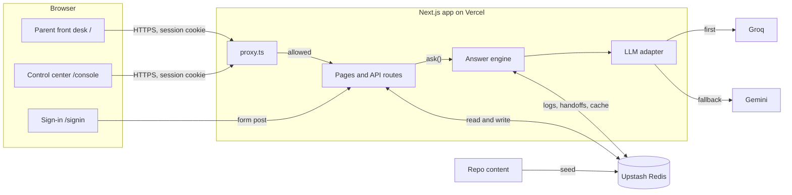

| Part | Where | Job |
|---|---|---|
| proxy.ts | `src/proxy.ts` | Runs before every page. Checks the session cookie and sends each person to the right place. |
| Parent view | `src/lib/parent-view.ts` | Builds everything the front desk shows on load: cards, menu, notices, chat suggestions. |
| Console view | `src/lib/console-view.ts` | Builds every tab of the control center in one pass. |
| Answer engine | `src/lib/engine/` | Turns a message into an answer, a question back, or a handoff. |
| LLM adapter | `src/lib/llm.ts`, `providers.ts` | Calls models with a JSON schema, time limits and fallbacks. |
| Facts | `src/lib/facts/` | Plain code for calendars, menus, illness rules and tour slots. |
| Store | `src/lib/store.ts`, `data.ts` | Redis access with one key prefix per environment, and seeding. |
| Content | `src/content/` | Handbooks in Markdown, centers, families and generated history. |

## 2. Data and storage

Every key starts with `afd:` plus the Vercel environment, so production, previews and local development share one database without touching each other's data: `afd:production:`, `afd:preview:` and `afd:local:`. Without Redis credentials, an in-memory store stands in and empties when the server restarts.

| Key | Holds | Written by |
|---|---|---|
| `center:{id}` | Hours, calendar, rooms, staff, tuition, saved answers, revision number | Seed, saved-answer edits |
| `handbook:{id}` | Handbook sections with titles, text and who updated them | Seed, Source of truth edits |
| `families:{id}` | Families, children, allergies, pickup lists, billing ledger | Seed only |
| `logs:{id}` | A list with one entry per question: lanes, sources, tokens, outcome, Maple's reply | Every answer |
| `handoffs:{id}` | All handoffs for the center, open and answered, with staff replies | Handoffs, staff replies |
| `feedback:{id}` | Thumbs up or down, keyed by log id | Parents |
| `feedback-handled:{id}` | Which unhelpful answers a director dealt with, and how | Control center |
| `tours`, `absences`, `lunches` | Bookings and orders from the action buttons | Actions |
| `cache:…` | Same-day replies (12 hours), translations and grouping results (7 days) | Engine, translation, control center |
| `seed:version`, `seed:at` | A fingerprint of the seed content, and when it was last seeded | Seed, Reset |

Most values are whole JSON documents. Adding a handoff reads the center's full list and writes it back. That is simple and fine for a demo, and it is the main reason storage changes in production (see [Known limits](#17-known-limits)).

## 3. Sign-in and sessions

**Trigger:** someone opens any page, or submits the sign-in form.

1. `proxy.ts` reads the `afd_session` cookie and verifies its HMAC signature with Web Crypto. A missing, forged or expired cookie sends the person to `/signin`, and a bad cookie is deleted.
2. On `/signin`, the form posts to the `signIn` server action. Typed sign-in needs a demo email and the shared demo password. The "Demo accounts" buttons send only the email.
3. The action writes a signed, httpOnly cookie holding the role, the center, and the family or staff id, valid for 7 days.
4. Parents go to `/` and directors to `/console`. The proxy keeps each role out of the other's pages.
5. API routes check the session themselves through `resolveParent` and `resolveDirector`. A parent always gets their own family, whatever the request body says.

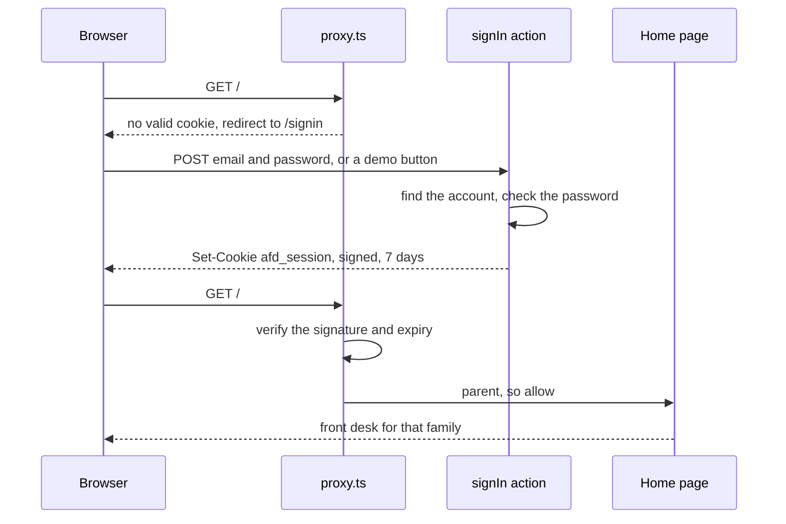

- Outside production, a request with no cookie may name a center and family in its body. The scorecard and curl tests rely on this. Production ignores it.
- Without `SESSION_SECRET`, a fixed demo key signs cookies. That is acceptable only because every account is public.

## 4. Loading the parent front desk

**Trigger:** a signed-in parent opens `/`.

1. The page reads the family from the session and calls `getParentView`.
2. That builds the cards from the center's data and today's date in the center's time zone: open status and hours, today's food with an allergy note per child, this week's menu, the next closure, and notices.
3. For a family that reads Spanish, Mandarin or Hindi, staff-written text such as dish names and notices is translated in one call to the large model, cached for a week. It gives up after 6 seconds and shows English.
4. The browser restores this family's chat from `localStorage`, then asks `/api/requests` for the family's handoffs, staff replies, absences, lunch orders and tour bookings, and asks again every 15 seconds.
5. A new staff reply turns Maple's bubble amber on phones until the parent opens the chat.

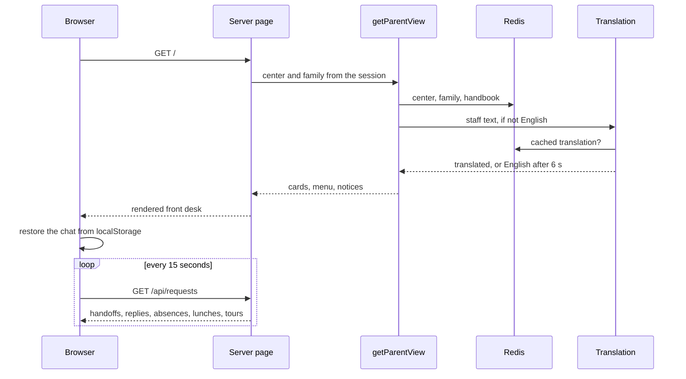

## 5. Asking Maple a question

**Trigger:** a parent sends a message. The browser posts the text and the conversation so far to `/api/ask`.

The engine tries the cheapest lane that can answer correctly, in a fixed order. Code handles everything well defined. Models are used to understand free text, to read the handbook, and to check claims. Anything unsure becomes a handoff.

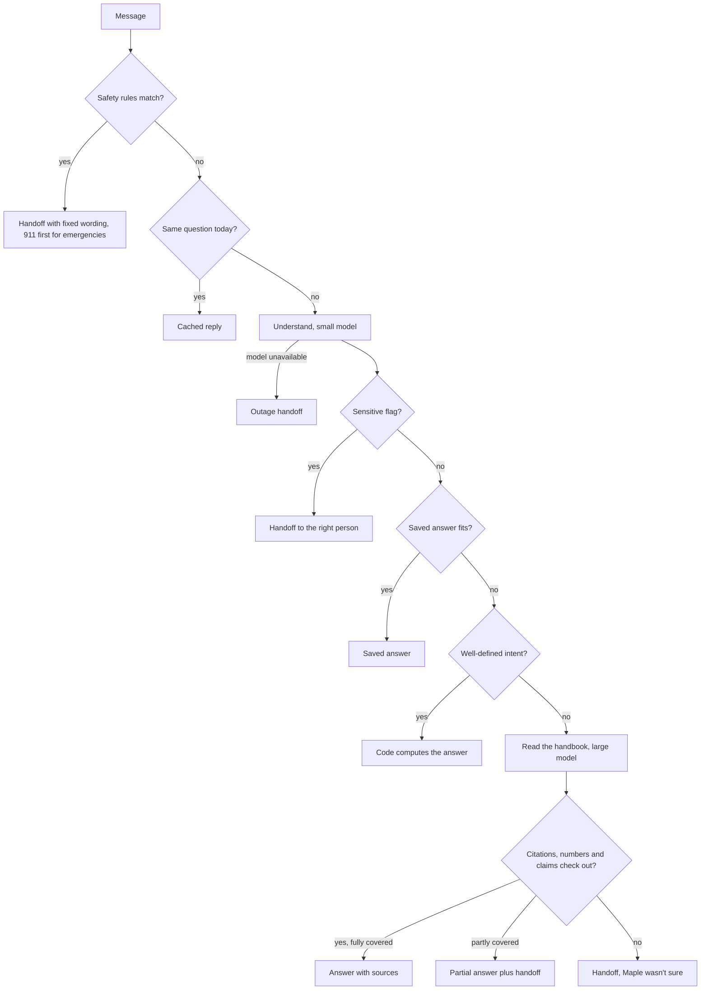

| Lane | Who | What it does |
|---|---|---|
| Safety rules | Code | Keyword patterns in English, Spanish, Mandarin and Hindi catch emergencies, custody and abuse before any model runs. The reply is fixed text per language. Custody and abuse replies cite the handbook's privacy promise. |
| Same-day cache | Code | For a first message with no history, the key combines the build, the center's revision, the family, today's date and the text. Only answers, questions back and polite refusals are cached. Handoffs never are, so each one reaches staff. |
| Understand | Small model | Returns the intent, which child, dates, symptoms and times, the language, sensitive flags, and a matching saved answer if one exists. With several children, a child counts only if the parent named them. If no model answers, the parent gets the outage handoff. |
| Sensitive topics | Code | Flags from the model back up the keyword rules: medical emergency, custody, abuse, pickup changes, injuries, complaints about staff, billing disputes and behavior. Each goes to a person with a short note of the next step. |
| Saved answers | Code | A director's saved answer is used as written, translated if needed. In English it must share a keyword with the message, because the model sometimes reaches for an unrelated one. |
| Look up | Code | Closures, hours, menus, forgotten lunch, illness return times, absences, tuition, waitlists, tours, billing and events are computed from tables and filled into templates. A closure question that mentions weather skips this lane and reads the weather policy instead. Questions about a child's day go to their teacher. |
| Read the handbook | Large model | Gets the whole handbook with section ids, the tables as text, today's date and time, this family's profile and the saved answers. Returns an answer, the ids it relied on, how fully the handbook covers it, and its confidence. |
| Double-check | Code, then small model | Code confirms every cited id exists and every price, date and percentage appears in a cited source. Then a small model checks that each claim is stated in the cited text. Any failure turns the answer into a handoff. |

Whatever the outcome, `finish()` appends a log entry with the lanes used, sources, real token counts, whether it was after hours, and Maple's reply. Handoffs are saved before the reply is returned, so the director's inbox already has them.

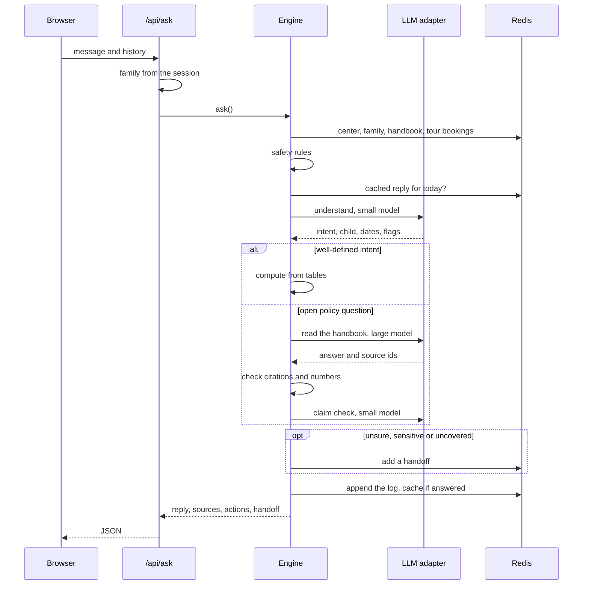

## 6. Model calls and fallback

**Trigger:** any step that needs a model calls `generateJson` with a tier, a prompt and a zod schema.

1. The tier picks a chain. Small: Groq gpt-oss-20b, then three Gemini Flash-Lite versions. Large: Groq gpt-oss-120b, then four Gemini Flash versions. `MODELS_SMALL` and `MODELS_LARGE` override the order.
2. Models that hit a daily limit, or are cooling down after a timeout or overload, are skipped. If every model is skipped, all of them are tried anyway.
3. Each call has a time limit: 7 seconds for small, 12 for large. The provider is asked for JSON matching the schema.
4. Invalid JSON or a schema mismatch gets one retry on the same model. A per-minute limit gets one short pause and a retry. An overload gets one retry, then a two-minute cooldown. A timeout moves straight to the next model with a cooldown. A daily limit benches the model until the provider says it resets.
5. When the chain runs out, the call throws `LlmUnavailableError`, and the engine turns it into a polite handoff.

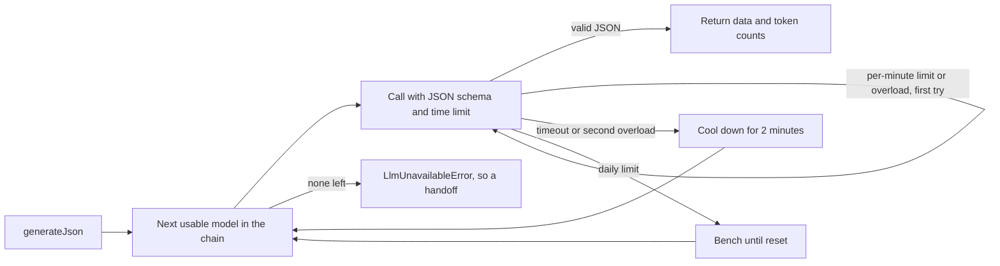

- Cooldowns and benches live in server memory, so each Vercel instance learns about a limit on its own.

## 7. Translation

**Trigger:** a reply, a card or a staff message needs to reach a parent who reads Spanish, Mandarin or Hindi.

1. Maple's templated answers are written in English and then translated. Handbook answers are written directly in the parent's language.
2. `translate()` tries the small model, then a small model from the other provider, then the large chain.
3. Each attempt must keep every number and every listed name exactly. A translation that changes a price, a time or "Quail Ridge" is rejected, and the next attempt runs.
4. If every attempt fails, the parent sees English. Staff replies record this as `keptEnglish`.
5. Spanish uses the formal "usted", and Hindi uses the respectful "आप" with feminine verb forms for Maple.

## 8. Actions: absences, backup lunch, tours

**Trigger:** a parent taps an action button on one of Maple's replies.

1. The browser posts the action to `/api/actions`. The family comes from the session.
2. The route recomputes everything that matters instead of trusting the browser: prices, menu items, open days and open tour times.
3. **Absence.** Dates before the next open day and closed days are dropped. If nothing is left, it answers with `day_over`.
4. **Backup lunch.** Only at centers where families pack lunch. After 10:30 am local time it answers with `lunch_closed`. The item is checked against the child's allergies.
5. **Tour.** The slot must still be open in the next 21 days and not already booked.
6. The record is saved, and the parent's requests list picks it up.

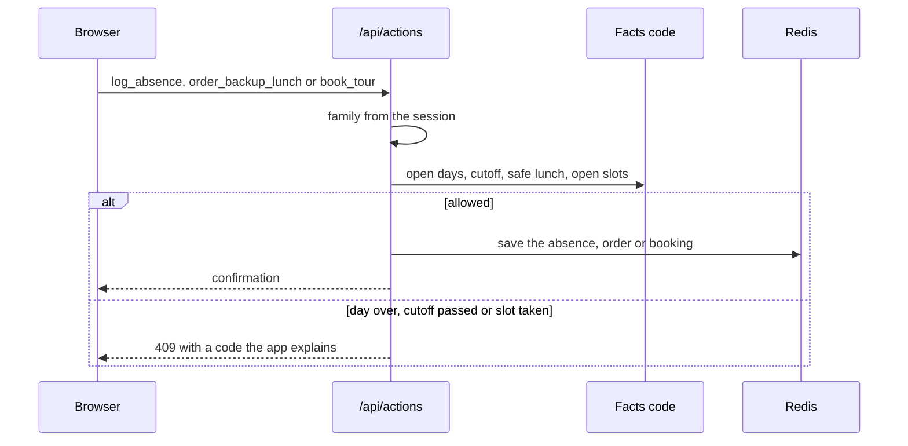

## 9. Feedback and "Talk to a person"

**Trigger:** a parent taps thumbs up or down under an answer.

1. The browser posts the log id and the vote to `/api/feedback`, which stores it in the center's feedback map.
2. After the second thumbs down in a conversation, Maple apologizes and offers "Talk to a person". The button stays in the chips until "Start over".
3. Tapping it posts to `/api/person` with Maple's last answer as context. That creates a handoff of kind `person` for the director and logs it, with no model involved.
4. Thumbs-down answers appear in the control center's Overview under "Answers parents found unhelpful".

## 10. From handoff to staff reply

**Trigger:** a director opens a waiting message in the inbox and replies.

1. Optional: "Draft with Maple" asks the small model for a 2 to 4 sentence reply that uses only the sources. Decisions it can't make go in brackets, such as "[Yes, costumes are welcome / No costumes this year]". Anything not in the sources is listed under "Not in the handbook".
2. The director sends. `sendReply()` translates the reply into the parent's language with names kept, stores the English beside it, and marks the handoff answered.
3. Within 15 seconds the parent's browser polls `/api/requests` and shows the reply under the original question, with the English one tap away.

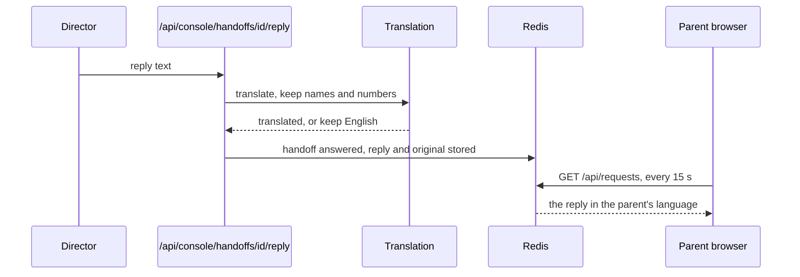

## 11. Answer once: saved answers and repeat questions

**Trigger:** a director replies to a general question, one the handbook didn't cover or Maple wasn't sure about.

1. When the inbox loads, general questions from the last 4 weeks are grouped by one small-model call on their English text. Each group shows as "Repeated question" on its members. Without a model, only identical wording groups.
2. After replying, "Save as an answer for everyone" asks the large model to draft a nameless question, a general answer and keywords, and opens them in a form. Nothing is saved or sent until the director edits and presses Save.
3. Saving adds the answer to the center and bumps the revision, so no cached reply outlives the change.
4. "Also send this answer to the others still waiting" is ticked for every open message in the group. Each family gets the answer in their language, and their handoff is marked answered.
5. The next parent who asks gets the saved answer through the Understand step, with no handbook read. Understand sees each saved answer's id and question, not its text, and returns an id only when one clearly answers the message.
6. When a group already has a saved answer, a new message in it shows "Send it to {parent}".

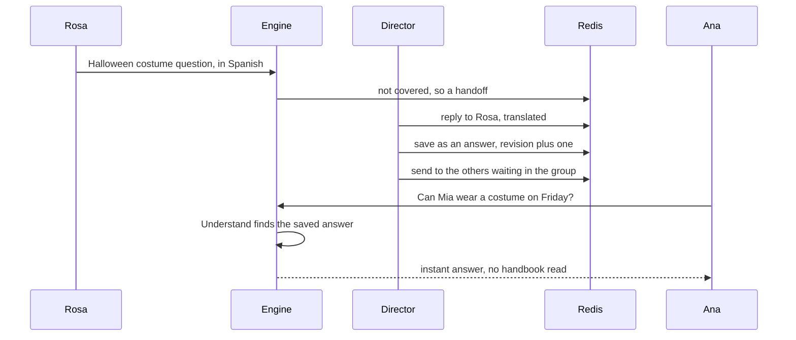

## 12. Loading the control center

**Trigger:** a signed-in director opens `/console`.

1. The page calls `getConsoleView`, which reads nine values in parallel: center, families, handbook, handoffs, logs, feedback, handled feedback, tour bookings and the seed time.
2. Non-English messages and unhelpful answers get English versions for the director, cached by content. The page waits at most 5 seconds and otherwise shows the original.
3. General questions are grouped for the inbox, also cached by content and limited to 5 seconds.
4. The view holds every tab: the inbox, the Overview's numbers for this week and last, Source of truth, and the families for Test Maple.
5. Switching tabs only changes the URL with `history.pushState`, so it makes no request. Every 20 seconds, while the tab is visible, the page refreshes its data from the server.

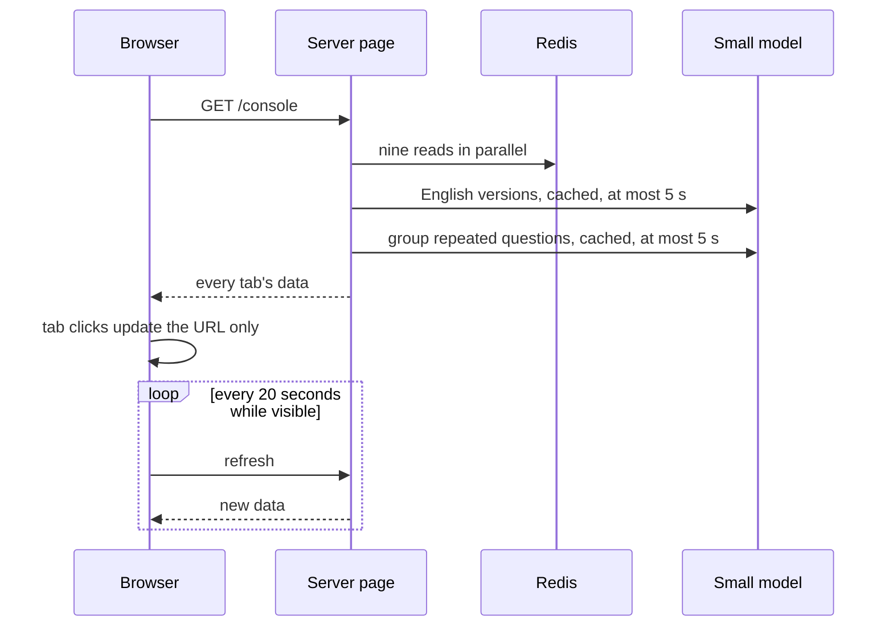

## 13. Editing the source of truth

**Trigger:** a director edits a handbook section or a saved answer, or follows "Fix source of truth" from an unhelpful answer.

1. Handbook edits go to `PATCH /api/console/handbook/{id}`, saved answers to `/api/console/answers/{id}`.
2. Each edit saves the change and bumps the center's revision. Reply-cache keys include the revision, so the next question uses the new text.
3. When the edit came from an unhelpful answer, that answer is marked handled, with how and by whom.
4. Hours, the calendar, tuition, the menu and tour times are shown read-only. Unhelpful answers drawn from them say "Read only for now" and link to the data.

## 14. Test Maple

**Trigger:** a director types a question in the Test Maple tab, as any family or as a visitor.

The route calls the same `ask()` with `dryRun` set. The engine runs every lane and returns the answer with its sources and steps, but writes no log, no handoff and no cache entry.

## 15. Seeding and reset

**Trigger:** the first data read after a deploy that changed the seed content, or a director pressing "Reset demo data".

1. At build time, `scripts/build-content.mjs` turns the Markdown handbooks into code.
2. Every data read first compares `seed:version` with a fingerprint of the content in code. When they differ, it reseeds once.
3. `resetDemo()` writes each center, handbook and family list. It generates 8 weeks of question history ending now, plus the questions waiting in each inbox.
4. It clears logs, handoffs, bookings, absences, lunch orders and feedback.
5. It sets each center's revision to the reset time, so no reply cached before the reset can be served after it.
6. The Reset button calls `POST /api/admin/reset`. In production this needs a signed-in director. It resets both centers.

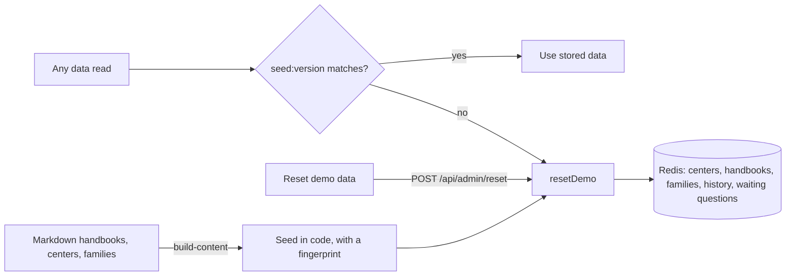

## 16. Scorecard and health checks

1. `npm run scorecard` runs 33 scenarios against a running server, with the clock pinned to Tuesday, October 13, 2026 at 8:10 am. Each checks the mode, the lanes and facts that must or must not appear. Reports go to `scorecard-results/`.
2. Scenario 15 walks the answer-once loop: it saves an answer through the control center API, asks, then deletes it.
3. `/api/health?live=1` round-trips the database and calls the first model of each step. `live=all` calls every model once.
4. Outside production, `/api/ask` also accepts a test clock, a simulated outage, a cache bypass and a model order.

## 17. Known limits

These are acceptable for a demo with a handful of users, and each one shapes the production design.

**Lost writes under load.** Handoffs, tour bookings, feedback and saved answers are each one JSON value per center, read and written back whole. Two writes at the same moment can lose one. Tour booking checks for a free slot and then saves, so two parents booking together can both succeed.

- Staff hear about handoffs only while the control center is open. Parents poll every 15 seconds, and the control center every 20.
- Model limits are tracked per server instance, and the live site and local testing share one set of free-tier keys and quota.
- Content lives in the repo. Changing it reseeds every environment on its next read, which clears that environment's data.
- Logs are one growing list per center, read whole by the control center.
- Sign-in is simulated, and every demo account is public.
